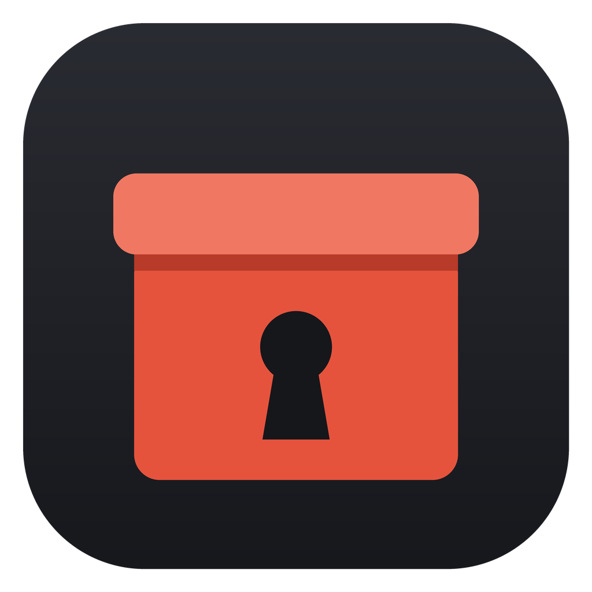
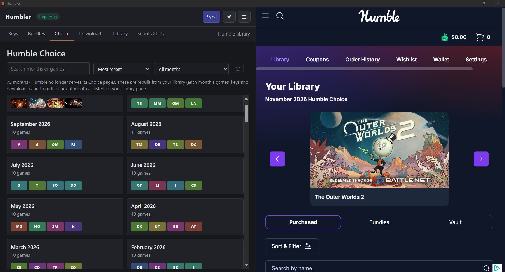

<h1 align="center">
  <br>
  Humbler
</h1>

A local client for your Humble Bundle library. It lets you see every key you
own, reveal and export keys in bulk, and download your files in bulk with
resume and checksum checks. You don't have to fight the website to do any of it.

It's an Electron app with two panes. The Humbler UI is on the left, and the
real humblebundle.com runs on the right, where you log in normally. Humbler
then loads your library the way Humble's own pages do, from inside your
logged-in session, so it only ever sees your own account.



## Install

Download the file for your system from the latest release:

| System | File |
|---|---|
| Windows | `Humbler-Setup-<version>.exe` (choose where to install, for you or everyone), or `Humbler-QuickSetup-<version>.exe` (one click, installs for you), or the `.zip` (no installer) |
| macOS | `Humbler-<version>-mac-arm64.dmg` (Apple Silicon) or `-x64.dmg` (Intel) |
| Linux | `Humbler-<version>-linux-x86_64.AppImage` (make it executable and run it), or the `.tar.gz` |

Builds aren't signed yet. On Windows, SmartScreen may say "Windows protected
your PC": choose More info → Run anyway. On macOS, right-click the app and
choose Open the first time.

An installed Humbler keeps your data (login, keys, settings, log) in
`%APPDATA%\Humbler` on Windows, `~/Library/Application Support/Humbler` on
macOS, and `~/.config/Humbler` on Linux. Uninstalling keeps it. When a newer
version is out, an update icon appears in the top bar: on Windows (either
setup) and the Linux AppImage it can install the update and restart; the zip,
tar.gz and macOS builds link to the release page. See [docs/data.md](docs/data.md) for
what's stored and how keys are protected.

## What it does

- **Keys**: every key you own, with reveal (one at a time or in a throttled
  batch), redeem links that pre-fill Steam/GOG/Epic, "did you redeem it?"
  tracking, expiry and sold-out warnings, copy and CSV/JSON export.
- **Downloads**: every file across every bundle, filtered by platform and
  format, downloaded in bulk with resume and MD5/SHA-1 checks. It finds files
  you already have in your existing download folders.
- **Library, Bundles and Choice**: everything you own, the old bundle pages,
  and the Choice month pages Humble's 2026 redesign removed.
- **Wishlists**: compare Steam wishlists (yours or friends') with your
  library: which spare keys someone wants, and which wishlisted games you
  already have.

Keys are encrypted at rest, and anything Humbler records for debugging is
scrubbed of keys before it's written.

## Docs

- [Using Humbler](docs/usage.md): each tab in detail, and staying logged in
- [Your data](docs/data.md): what's stored where, and how it's encrypted
- [Harvesting, scouting and scrubbing](docs/scouting.md): how Humbler copes
  when Humble changes its site
- [How Humbler talks to Humble](docs/humble-api.md): the requests it makes
- [Development](docs/development.md): building from source, scripts, code layout
- [Releasing](docs/RELEASING.md): building and publishing releases

## Running from source

```
npm install
npm start
```

See [docs/development.md](docs/development.md) for the rest.

## License

MIT. See [LICENSE](LICENSE).
